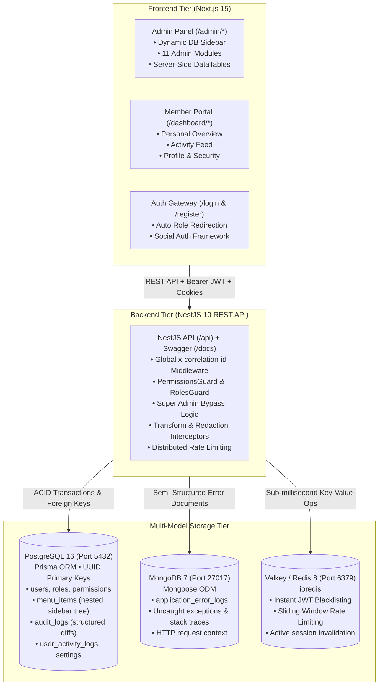

# Scalable Full-Stack Monorepo Architecture

A production-ready full-stack monorepo featuring **Next.js 15+ (App Router)**, **NestJS 10+ REST API**, **PostgreSQL (Prisma ORM)**, **MongoDB (Mongoose ODM)**, and **Valkey (Redis-compatible In-Memory Cache)** with a comprehensive **Role-Based Admin Panel**, **Database-Driven Dynamic Sidebar**, and **Dedicated User Portal**.

---

## 🏗️ Architecture Overview



---

## 📁 Monorepo Structure

```text
my-monorepo/
├── apps/
│   ├── web/                         # Next.js 15+ App Router frontend
│   │   ├── src/
│   │   │   ├── app/
│   │   │   │   ├── admin/           # Admin Panel (Role Guarded: SUPER_ADMIN, ADMIN, MODERATOR)
│   │   │   │   │   ├── dashboard/   # Module 1: System overview & metrics
│   │   │   │   │   ├── roles/       # Module 2: Roles & permissions management
│   │   │   │   │   ├── users/       # Module 3: Full user management data table
│   │   │   │   │   ├── moderators/  # Module 4: Moderator management
│   │   │   │   │   ├── navigation/  # Module 5: Dynamic sidebar hierarchy manager
│   │   │   │   │   ├── audit-logs/  # Module 6: PostgreSQL structured audit logs & diffs
│   │   │   │   │   ├── activity-logs/# Module 7: User activity tracking
│   │   │   │   │   ├── error-logs/  # Module 8: MongoDB exception logs & stack traces
│   │   │   │   │   ├── settings/    # Module 9: System default settings editor
│   │   │   │   │   ├── profile/     # Module 10: Admin profile & password change
│   │   │   │   │   ├── health/      # Module 11: Real-time service health benchmarks
│   │   │   │   │   ├── knowledge-graph/ # Module 12: Knowledge graph AST explorer
│   │   │   │   │   └── layout.tsx   # Admin layout with dynamic DB sidebar
│   │   │   │   ├── dashboard/       # Standard User Portal (Isolated from Admin)
│   │   │   │   │   ├── profile/     # User profile & verified password change
│   │   │   │   │   ├── layout.tsx   # User portal navigation layout
│   │   │   │   │   └── page.tsx     # User welcome, summary & personal activities
│   │   │   │   ├── (auth)/          # Authentication pages (login, register)
│   │   │   │   ├── layout.tsx       # Root layout with AuthProvider
│   │   │   │   └── page.tsx         # Smart root redirect based on user role
│   │   │   ├── components/
│   │   │   │   ├── data-table/      # Reusable generic DataTable component
│   │   │   │   ├── layout/          # AdminSidebar, AdminTopbar
│   │   │   │   ├── ui/              # Reusable Button, Modal, Badge, Card, Breadcrumbs, etc.
│   │   │   │   └── users/           # UserFormModal, DeleteUserModal
│   │   │   ├── context/             # AuthContext (Role redirection & session management)
│   │   │   └── lib/                 # ApiClient with automatic token refresh
│   │   ├── package.json
│   │   └── tsconfig.json
│   │
│   ├── mobile/                      # React Native 0.76+ & Expo 52+ Cross-Platform Mobile App
│   │   ├── src/
│   │   │   ├── screens/             # Login, Register, UserDashboard, AdminDashboard, Users, Roles, Logs, Health, Graph
│   │   │   ├── components/          # Native Badge, Button, Input, Card, HostSettingsModal
│   │   │   ├── context/             # Mobile AuthContext & ThemeContext
│   │   │   └── lib/                 # Mobile ApiClient (Expo SecureStore + Bearer tokens + 10.0.2.2/LAN resolver)
│   │   ├── metro.config.js          # Monorepo pnpm symlink & package resolver
│   │   ├── app.json                 # Expo configuration (com.monorepo.mobile)
│   │   ├── eas.json                 # Android APK preview & production builds
│   │   └── package.json
│   │
│   └── api/                         # NestJS 10+ REST API backend
│       ├── src/
│       │   ├── auth/                # JWT Auth, Argon2id/Bcrypt hashing, refresh tokens, guards
│       │   ├── users/               # User management, profile endpoints, metrics
│       │   ├── roles/               # Role & permission matrix endpoints
│       │   ├── navigation/          # Dynamic DB menu tree & circular reference detection
│       │   ├── audit/               # PostgreSQL structured audit logs & MongoDB error logs
│       │   ├── activity/            # User activity log tracking & personal feed
│       │   ├── settings/            # Default settings management
│       │   ├── cache/               # Valkey cache service & distributed rate limiter
│       │   ├── health/              # Multi-tier health probe (PG, Mongo, Valkey)
│       │   ├── common/              # Correlation ID middleware, HttpExceptionFilter, interceptors
│       │   ├── database/            # PrismaService
│       │   ├── app.module.ts
│       │   └── main.ts
│       ├── prisma/
│       │   ├── schema.prisma        # UUID-based relational schema
│       │   └── seed.ts              # Database seeder with roles, menus, settings, & users
│       ├── package.json
│       └── tsconfig.json
│
├── packages/
│   ├── shared-types/                # TypeScript interfaces, enums, DTOs, and contracts
│   ├── shared-utils/                # Menu tree builders, circular checks, redaction, pagination
│   ├── validation/                  # Zod validation schemas
│   └── config/                      # Base TypeScript & configuration packages
│
├── docker-compose.yml               # PostgreSQL, MongoDB, and Valkey containers
├── pnpm-workspace.yaml              # pnpm workspace definition
├── package.json                     # Monorepo scripts (dev, build, test, db:seed)
├── tsconfig.base.json
└── README.md
```

---

## 🔐 Role-Based Access Control & Privilege Hierarchy

The system supports 4 distinct roles with strict privilege hierarchy:

```
SUPER_ADMIN (Bypasses individual permissions; Full control)
   └── ADMIN (Explicitly granted administrative permissions)
        └── MODERATOR (Explicitly granted moderation permissions)
             └── USER (Isolated to personal member endpoints)
```

### 1. Granular Permission Matrix (12 Standard Permissions)
- `users.read`: View users and user profiles
- `users.create`: Provision new accounts
- `users.update`: Modify existing user attributes and statuses
- `users.delete`: Delete user accounts
- `users.view_activity`: Inspect audit histories and user activity logs
- `roles.manage`: Create, edit, and assign roles
- `permissions.manage`: Assign permissions to roles
- `navigation.manage`: Manage database-driven navigation items
- `audit_logs.read`: Access PostgreSQL structured audit logs
- `error_logs.read`: Inspect MongoDB application error traces
- `settings.manage`: Modify default system settings
- `moderators.manage`: Provision and manage moderator privileges

### 2. Security Safeguards & Enforcement
- **Backend-First Authorization:** Every protected NestJS endpoint enforces `JwtAuthGuard`, `RolesGuard`, and `PermissionsGuard`. Hiding a frontend sidebar item is never treated as security.
- **Protection of Last Active Super Admin:** Attempting to delete, deactivate, or demote the last remaining active Super Admin returns an explicit HTTP 400 rejection.
- **Privilege Escalation Prevention:** Administrators cannot grant themselves or others privileges they do not possess.
- **Auditing & Correlation:** Every request receives an `x-correlation-id` header passed into structured audit logs and MongoDB error telemetry.
- **Automatic Sanitization:** All sensitive credentials (`password`, `accessToken`, `refreshToken`, `client_secret`) are automatically redacted before logging.

---

## 🗄️ Polyglot Database Storage Strategy

| Storage Engine | Technology | Role in System | What Is Stored Here |
| :--- | :--- | :--- | :--- |
| **Relational Database** | **PostgreSQL 16** (Prisma ORM) | Primary ACID Store | `users`, `roles`, `permissions`, `menu_items`, `audit_logs`, `user_activity_logs`, `settings`, `refresh_tokens`. |
| **Document Database** | **MongoDB 7** (Mongoose ODM) | Unstructured Telemetry | `application_error_logs` (captures uncaught exceptions, stack traces, and dynamic HTTP request payloads). |
| **In-Memory Cache** | **Valkey 8** (ioredis) | Ephemeral Speed Tier | Revoked JWT blacklist, sliding window rate-limiting counters, and session state. |

---

## 🖥️ Admin Navigation Modules & User Experience

### 12 Admin Navigation Modules (`/admin/*`)
1. **Dashboard (`/admin/dashboard`):** System metrics, 7-day registration trends, active vs. inactive users, and service health indicators.
2. **Role & Permission Management (`/admin/roles`):** Matrix of roles and the 12 granular permissions with real-time toggle updates.
3. **User Management (`/admin/users`):** Full CRUD data table, server pagination, sorting, status/role filtering, and Super Admin activity history modal.
4. **Moderator Management (`/admin/moderators`):** Dedicated view for moderator oversight and permission tuning.
5. **Navigation Management (`/admin/navigation`):** Tree manager for dynamic PostgreSQL sidebar items with circular reference prevention.
6. **Audit Logs (`/admin/audit-logs`):** Structured PostgreSQL logs showing state transitions (Before vs. After JSON diff viewer).
7. **User Activity Logs (`/admin/activity-logs`):** Real-time tracking of logins, logouts, profile changes, and administrative actions with IP attribution.
8. **Application Error Logs (`/admin/error-logs`):** MongoDB telemetry viewer with status code badges and formatted stack trace modal.
9. **Default Settings (`/admin/settings`):** Category-grouped system settings with inline editing and JSON validation.
10. **Profile Management (`/admin/profile`):** Personal administrative details and verified password change.
11. **System Health & Monitoring (`/admin/health`):** Live latency and heartbeat probes for PostgreSQL, MongoDB, Valkey, and API uptime with 5s polling.
12. **Codebase Knowledge Graph (`/admin/knowledge-graph`):** Interactive AST topology viewer, BFS dependency path tracer, call-flow sequences, and live graph metrics.

### Member Portal (`/dashboard/*`)
- **Dashboard Overview (`/dashboard`):** Welcome banner, security summary, and personal activity feed (`GET /api/activity-logs/me`).
- **Profile & Security (`/dashboard/profile`):** Personal contact information update and secure password change.

---

## 📱 Cross-Platform Mobile Application (`apps/mobile`)

The monorepo contains a **React Native (Expo SDK 52+)** mobile application for iOS and Android, sharing 100% of the TypeScript interfaces, Zod validation schemas, and API contracts with the web frontend.

### 1. Parity & Architecture Symmetry
- **Shared Contracts:** Consumes `@monorepo/shared-types` (Auth, User, Role DTOs) and `@monorepo/validation` (Zod login and register form schemas).
- **Identical API Calls:** Communicates with the same NestJS backend endpoints (`/api/auth/*`, `/api/users/*`, `/api/roles/*`, `/api/activity-logs/*`, `/api/health`, `/api/graphify/stats`) with automatic JWT bearer token attachment and refresh logic.
- **Role-Based Routing:**
  - `USER`: Redirects to the mobile Member Portal with personal security overview and activity stream.
  - `SUPER_ADMIN`, `ADMIN`, `MODERATOR`: Redirects to the mobile Admin Console with live system metrics, user table, role matrix, and health probes.
- **Storage & Security:** Uses `expo-secure-store` to keep access and refresh tokens safely stored in Android KeyStore and iOS Keychain.
- **Dynamic Server Host Config:** Includes an in-app Server Host modal allowing developers to switch between `10.0.2.2` (Android emulator), `localhost` (iOS simulator), and local WiFi LAN IP (`192.168.x.x`) for physical device testing without recompiling.

### 2. Mobile CLI Scripts
```bash
pnpm mobile             # Start Expo Metro development server
pnpm mobile:android     # Launch in Android emulator / connected device
pnpm mobile:ios         # Launch in iOS simulator
pnpm mobile:web         # Run mobile layout in web browser
pnpm mobile:build:apk   # Prebuild and generate standalone release Android APK (.apk)
```

### 3. Automated Android APK CI/CD
The monorepo includes [`.github/workflows/mobile-apk.yml`](file:///.github/workflows/mobile-apk.yml). On push to `main` or manual trigger (`workflow_dispatch`), GitHub Actions compiles the Android release APK and publishes it as a downloadable artifact.

---

## 🧠 Graphify Codebase Knowledge Graph & AST Architecture Intelligence

The monorepo includes **Graphify** (`Graphify-Labs/graphify`) integration across all layers (CLI, Antigravity AI assistant, NestJS REST API, and Next.js Admin UI):

- **AST Parsing Engine:** Tree-Sitter AST parsers for TypeScript, JavaScript, and SQL. Extracts functions, classes, decorators, schema models, imports, and cross-package references.
- **Knowledge Topology:** 1,127 nodes, 2,415 edges, and 63 modular communities with a 39.0x token reduction efficiency.
- **Dedicated NestJS Module (`GraphifyModule`):**
  - `GET /api/graphify/stats` - Graph summary, node counts, community distribution, top architectural hubs.
  - `GET /api/graphify/search?q=<query>` - Substring and fuzzy node symbol search.
  - `GET /api/graphify/node/:id` - Detailed symbol inspection with incoming & outgoing edges.
  - `GET /api/graphify/path?from=<nodeA>&to=<nodeB>` - Breadth-First-Search (BFS) shortest path tracer.
  - `POST /api/graphify/refresh` - On-demand AST graph re-extraction.
- **Interactive Admin UI (`/admin/knowledge-graph`):**
  - **Force-Directed Graph Viewer:** Embedded interactive D3/SVG graph canvas.
  - **Symbol & Path Explorer:** Interactive source-to-target path tracer and relationship inspector.
  - **Mermaid Call-Flow Diagrams:** Visualized architectural call sequence diagrams.
  - **Collapsible File & Symbol Tree:** Hierarchical monorepo code structure view.
- **Documentation & Obsidian Vault:**
  - 73 detailed wiki articles in `graphify-out/wiki/`.
  - Comprehensive Obsidian vault in `graphify-out/obsidian/` with canvas support.
- **Git Lifecycle Automation:**
  - Automated `post-commit`, `post-checkout`, `post-merge`, and `post-rewrite` hooks.
  - Custom git merge driver for `graphify-out/graph.json` to prevent merge conflicts.
- **CLI Scripts:**
  ```bash
  pnpm graphify          # Re-extract AST and rebuild knowledge graph
  pnpm graphify:export   # Export HTML visualization, tree view, and callflow diagrams
  pnpm graphify:tree     # Generate collapsible dependency tree
  pnpm graphify:callflow # Generate Mermaid call-flow sequences
  pnpm graphify:benchmark# Measure AST extraction benchmarks
  ```

---

## 🔑 Default Seed Credentials

All test accounts are seeded with pre-configured roles:

| Role | Email | Password | Access Target |
| :--- | :--- | :--- | :--- |
| **SUPER_ADMIN** | `superadmin@example.com` | `SuperAdmin123!` | `/admin/dashboard` (Full system bypass) |
| **ADMIN** | `admin@example.com` | `Admin123!` | `/admin/dashboard` (Granted permissions) |
| **MODERATOR** | `moderator@example.com` | `User123!` | `/admin/dashboard` (Moderation subset) |
| **USER** | `user@example.com` | `User123!` | `/dashboard` (Member Portal) |

> [!NOTE]
> The login interface contains no role dropdown; destination routing is determined dynamically by the backend following authentication.

---

## 🚀 Getting Started

### 1. Prerequisites
- **Node.js** >= 20.x
- **pnpm** >= 9.x (`npm install -g pnpm`)
- **Docker** & **Docker Compose**

### 2. Start Database Services
```bash
docker compose up -d
docker compose ps
```

### 3. Initialize Database & Seed
```bash
# Push Prisma schema and seed default data
pnpm --filter api db:push
pnpm --filter api db:seed
```

### 4. Run Development Servers
```bash
# Concurrently starts NestJS API (Port 4000) and Next.js Frontend (Port 3000)
pnpm dev
```

### 5. Run Production Build
```bash
# Builds all shared packages, api, and web applications
pnpm build
```

### 6. Run Test Suite
```bash
# Executes unit tests for shared utilities and privilege hierarchy rules
pnpm test
```

---

## 🌐 Endpoints & Interactive Documentation
- **Frontend Web App:** `http://localhost:3000`
- **NestJS REST API:** `http://localhost:4000/api`
- **Interactive Swagger Docs:** `http://localhost:4000/docs`
- **Health Check Probe:** `http://localhost:4000/api/health`
