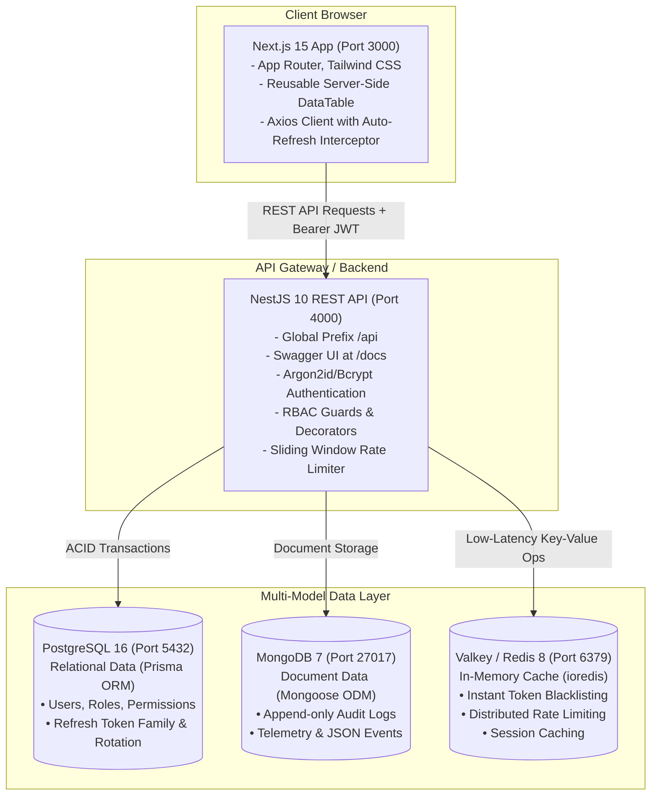

# Scalable Full-Stack Monorepo Architecture

A production-ready full-stack monorepo built with **Next.js 15+ (App Router)**, **NestJS 10+**, **PostgreSQL (Prisma ORM)**, **MongoDB (Mongoose ODM)**, and **Valkey (Redis-compatible In-Memory Cache)**.

---

## 🏗️ Architecture Overview



---

## 📁 Monorepo Structure

```text
my-monorepo/
├── apps/
│   ├── web/                         # Next.js 15+ App Router frontend
│   │   ├── src/
│   │   │   ├── app/                 # (auth) & (dashboard) route groups
│   │   │   ├── components/
│   │   │   │   ├── data-table/      # Reusable server-paginated, sortable DataTable
│   │   │   │   ├── users/           # User form & delete modals
│   │   │   │   └── ui/              # Button, Input, Select, Badge, Modal
│   │   │   ├── context/             # AuthContext (JWT management & session state)
│   │   │   └── lib/                 # HTTP client with automatic refresh-token rotation
│   │   ├── package.json
│   │   └── tsconfig.json
│   │
│   └── api/                         # NestJS 10+ REST API backend
│       ├── src/
│       │   ├── auth/                # JWT Auth, refresh-token rotation, RBAC guards
│       │   ├── users/               # CRUD with server pagination, search & filters
│       │   ├── audit/               # MongoDB Mongoose schemas & audit logging
│       │   ├── cache/               # Valkey (Redis-compatible) cache service & limiter
│       │   ├── common/              # Global filters, interceptors, and rate-limit guards
│       │   ├── database/            # PrismaService lifecycle management
│       │   ├── health/              # Multi-database health probe (PG, Mongo, Valkey)
│       │   ├── config/              # Dynamic configuration module
│       │   ├── app.module.ts
│       │   └── main.ts              # Swagger & CORS bootstrap
│       ├── prisma/
│       │   ├── schema.prisma        # PostgreSQL Schema
│       │   └── seed.ts              # Idempotent DB seeder
│       ├── package.json
│       └── tsconfig.json
│
├── packages/
│   ├── shared-types/                # Shared TypeScript contracts & DTOs
│   ├── shared-utils/                # Pagination math, formatters, and sanitizers
│   ├── validation/                  # Zod validation schemas shared across web & api
│   └── config/                      # Base TypeScript, ESLint, and Next/Nest configs
│
├── docker/
│   ├── postgres/init.sql            # Postgres extensions initialization
│   ├── mongo/init.js                # Mongo collections & indexes initialization
│   └── valkey/valkey.conf           # Valkey memory limit and eviction policy
├── docker-compose.yml               # Multi-container local environment
├── pnpm-workspace.yaml              # pnpm workspace definition
├── tsconfig.base.json               # Root TypeScript path mappings
├── .env.example                     # Environment template
└── README.md
```

---

## 🗄️ Database Storage Strategy: Relational vs Document vs Cache

A modern application benefits from choosing the **optimal storage engine for each workload**:

| Engine | Storage Paradigm | Primary Purpose | What Is Stored Here | Why This Choice? |
| :--- | :--- | :--- | :--- | :--- |
| **PostgreSQL** | Relational / ACID | Primary source of truth for structured entity relationships. | `users`, `roles`, `permissions`, `refresh_tokens`. | Relational integrity, foreign-key cascades on deletion, unique constraints on emails and hashed tokens, strict schema evolution via Prisma migrations. |
| **MongoDB** | Document-Oriented | Append-only event logs, semi-structured telemetry, and dynamic payloads. | `audit_logs` (tracking logins, profile edits, deletions, user-agent metadata). | Flexible schema accommodates evolving event metadata without costly migrations; high append throughput; document nesting. |
| **Valkey** | In-Memory Key-Value | Ultra-low latency data with transient lifecycles and high eviction rate. | Active token whitelists, blacklisted token IDs, sliding-window rate limit counters. | Sub-millisecond response time; atomic increments (`INCR`, `EXPIRE`); prevents database bottlenecks for repetitive operations. |

---

## 🔐 Authentication & Authorization Deep Dive

### 1. Authentication (Who You Are)
- **Password Hashing:** Passwords are never stored in plaintext. They are salted and hashed using **Argon2id / bcrypt** with a cost factor of 10.
- **Short-Lived Access Tokens:** Signed JWT containing `sub` (User ID), `email`, `role`, and a unique `tokenId` (UUID). Valid for **15 minutes**.
- **Long-Lived Refresh Tokens:** Signed JWT stored in PostgreSQL with a SHA-256 hash. Valid for **7 days**. Delivered via **HTTP-only cookie** or JSON payload.
- **Refresh Token Rotation:** Every time a refresh token is exchanged, the existing refresh token is marked as `revoked: true` and a completely new pair is issued. If a revoked token is ever presented, the backend rejects it immediately (protecting against replay attacks).
- **Instant Token Revocation:** When a user logs out or modifies critical security details, their `tokenId` is immediately written to Valkey with a TTL matching the token's remaining lifespan. The NestJS `JwtStrategy` performs an instantaneous sub-millisecond check against Valkey to block blacklisted tokens before reaching any controller logic.

### 2. Authorization (What You Can Do)
- **Role-Based Access Control (RBAC):** Supported roles: `ADMIN`, `MODERATOR`, `USER`.
- **Custom Decorator:** `@Roles(UserRole.ADMIN, UserRole.MODERATOR)` applied directly on controller endpoints.
- **Roles Guard:** Intercepts incoming requests after JWT verification, validates the user's role against the required metadata, and denies access with a `403 Forbidden` response if the role does not have sufficient clearance.

---

## 🚀 Step-by-Step Setup & Quick Start

### 1. Prerequisites
- **Node.js** >= 20.x
- **pnpm** >= 9.x (`npm install -g pnpm`)
- **Docker** and **Docker Compose**

### 2. Clone and Install Dependencies
```bash
# Clone the repository
git clone <repo-url>
cd <repo-dir>

# Install all monorepo workspace dependencies
pnpm install
```

### 3. Start Database Containers
```bash
# Start PostgreSQL (5432), MongoDB (27017), and Valkey (6379)
docker compose up -d

# Verify all containers are healthy
docker compose ps
```

### 4. Configure Environment Variables
```bash
cp .env.example .env
```

### 5. Run Database Migrations and Seed
```bash
# Push schema to PostgreSQL and generate Prisma client
pnpm db:migrate

# Seed default administrator, moderator, and sample data table users
pnpm db:seed
```

### 6. Start the Development Servers
```bash
# Starts both NestJS API (4000) and Next.js Frontend (3000) concurrently with hot-reloading
pnpm dev
```

---

## 🔑 Default Seed Credentials

| Role | Email | Password | Access Level |
| :--- | :--- | :--- | :--- |
| **Admin** | `admin@example.com` | `Admin123!` | Full CRUD, User deletion, RBAC management, Audit log access |
| **Moderator** | `moderator@example.com` | `User123!` | User viewing & updates, Audit log access |
| **User** | `user@example.com` | `User123!` | Standard member access |

---

## 📊 Reusable Data Table Component Features

The Next.js frontend includes a generic, reusable `<DataTable<T> />` component built with TypeScript:

1. **Server-Side Pagination:** Interacts directly with NestJS pagination metadata (`page`, `limit`, `totalItems`, `totalPages`, `hasNextPage`, `hasPrevPage`).
2. **Dynamic Sorting:** Click on any column header to toggle `asc`, `desc`, or default sort order with visual indicators.
3. **Debounced Search:** Live filter across user fields (`name`, `email`) with a 350ms debounce window.
4. **Multi-Faceted Filtering:** Dropdown filters for RBAC Roles (`ADMIN`, `MODERATOR`, `USER`) and Statuses (`ACTIVE`, `INACTIVE`, `SUSPENDED`).
5. **Robust State Handling:**
   - **Loading:** Smooth animated skeleton placeholders.
   - **Empty:** Clean illustrative message with reset suggestions.
   - **Error:** Interactive error banner with a one-click `Retry` action.
6. **Row Selection:** Bulk selection checkbox supporting indeterminate state.
7. **Complete CRUD Operations:** Create user modal with validation, inline update modal, and secure delete confirmation modal.

---

## 🛠️ Health Checks & Observability

- **API Health Endpoint:** `GET http://localhost:4000/api/health`
  - Tests PostgreSQL connection via `SELECT 1`.
  - Tests MongoDB connection via Mongoose `connection.readyState`.
  - Tests Valkey connection via `PING -> PONG`.
  - Returns individual latency metrics and system uptime.
- **Interactive Swagger Documentation:** `http://localhost:4000/docs`

---

## 🚢 Production Deployment Guidelines

1. **Containerized Build:** Use multi-stage Dockerfiles for `apps/web` and `apps/api` with standalone Next.js output and pruned pnpm dependencies.
2. **Reverse Proxy:** Terminate SSL/TLS at Nginx, Cloudflare, or AWS ALB, proxying `/api` traffic to the NestJS cluster and `/` to Next.js.
3. **Managed Services:** Seamlessly swap Docker containers for managed cloud services:
   - PostgreSQL -> Amazon RDS / Supabase / Cloud SQL
   - MongoDB -> MongoDB Atlas
   - Valkey -> AWS ElastiCache / Redis Cloud
4. **Environment Secrets:** Store `JWT_ACCESS_SECRET`, `JWT_REFRESH_SECRET`, and database connection strings in AWS Secrets Manager or HashiCorp Vault.

